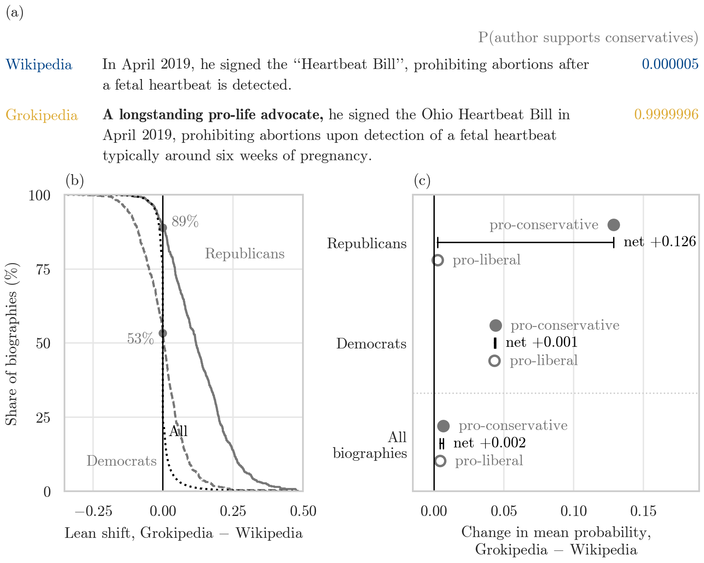

# Replication package: Grokipedia stretches the US political spectrum

Code and data for the article by Philipp Koch and Alexander Posztos. We compare Wikipedia and Grokipedia
biographies of 1,614 Democratic and Republican politicians, with 98,013 paired biographies of notable people as a
reference group. One script recreates the figures and statistics of the article and checks them against the
manuscript.



## How to run it

You need Python 3.11. Package versions are pinned in `requirements.txt`.

```bash
git clone https://github.com/philmkoch/grokipedia-replication.git
cd grokipedia-replication
python -m venv .venv
source .venv/bin/activate                        # Windows: .venv\Scripts\activate
pip install -r requirements.txt
python reproduce.py
```

`reproduce.py` first downloads the two text corpora with `download_data.py`, then runs the analysis. 

Figures go to `out/figures/`, numbers to `out/*/results.json`, and the report `out/manuscript_check.md` compares
85 numbers of the manuscript and both figures (`expected/fig1.png`, `expected/fig2.png`) with the output. A
successful run ends with "85 of 85 claims reproduce"; if anything fails, the script exits with status 1. Last full
run: 23 November 2026, Windows 11, Python 3.11.18, all 85 checks pass.

Use `python reproduce.py --skip-download` when the corpora are already in `data/`. To run only some steps, name
them, as in `python reproduce.py ideology musk`. 

| Manuscript | Script | Output |
|---|---|---|
| Fig. 1, Fig. 2 | `fig1_reference.py`, `paper_figures.py` | `out/figures/` |
| Party averages, November snapshot | `results.py`, `rescrape.py` | `out/results.json`, `out/november/results.json` |
| Ideology slopes and robustness | `ideology.py` | `out/ideology/results.json` |
| America PAC test | `musk_support.py` | `out/musk/results.json` |

## Going beyond this replication package

- Scoring the texts (`features.py`) needs a GPU and the packages in `requirements-features.txt`. The scores are
  shipped in `features/`.
- Collecting the texts (`collect.py`, `collect_november.py`) scrapes the live sites and would give today's
  articles, not the corpus of the paper. The raw February scrape is not distributed.

`data/README.md` describes every data file and its source.

Further information can be found in https://github.com/alexander-posztos/grokipedia-bias.

## Data terms, licence and citation

The two text corpora are not in git and are not covered by the MIT licence. Use them only for replication and
other research; the full terms are in `data/README.md`. The code is under the MIT
licence (`LICENSE`). Please cite the article and this repository (`CITATION.cff`).
